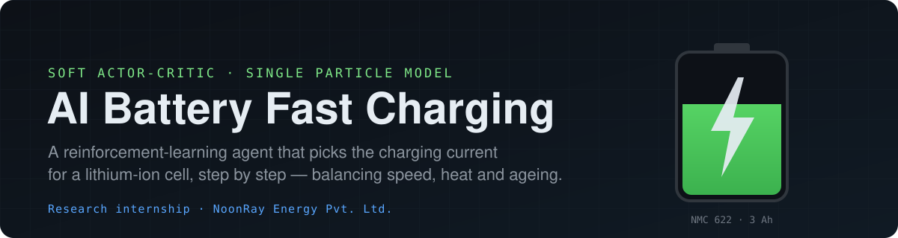
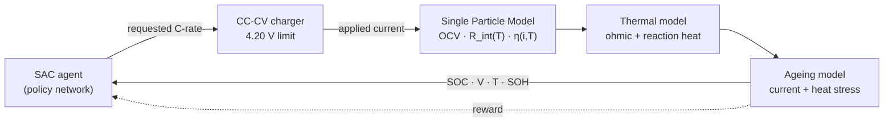
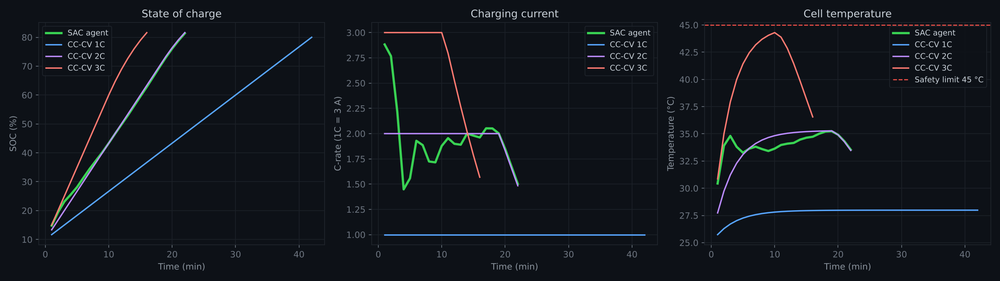
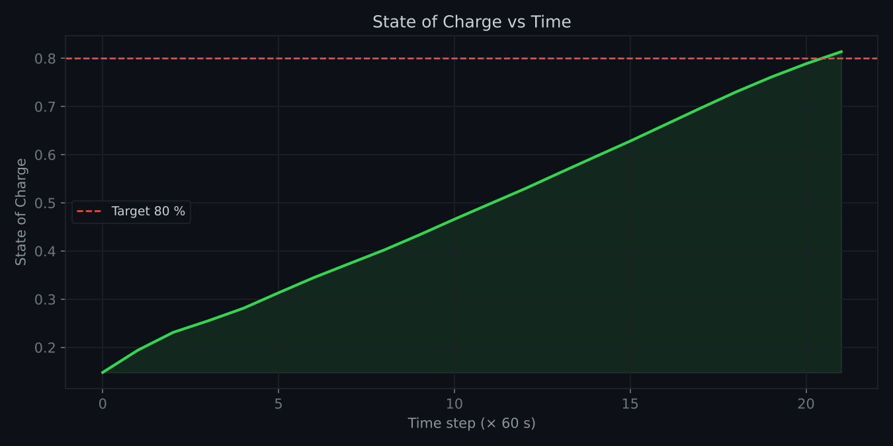
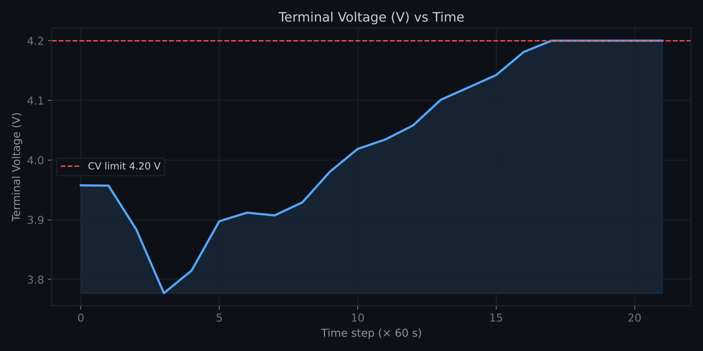
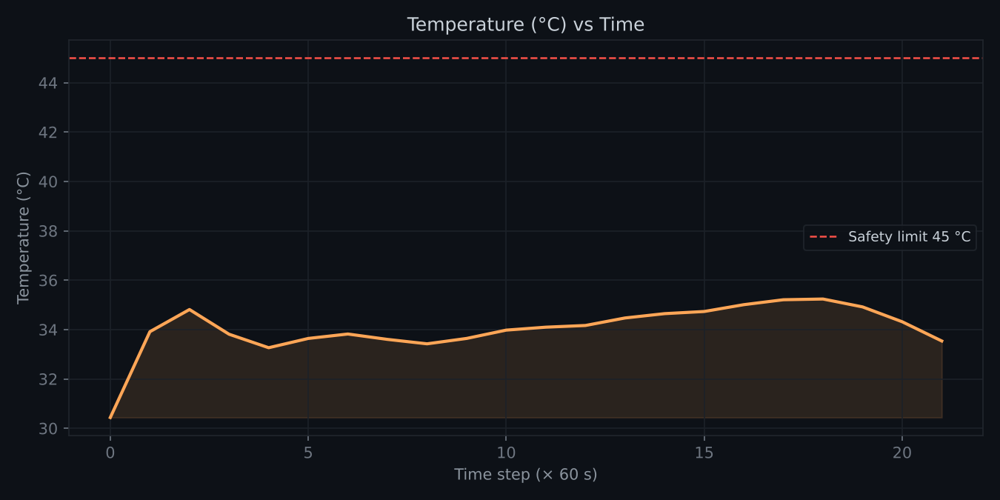
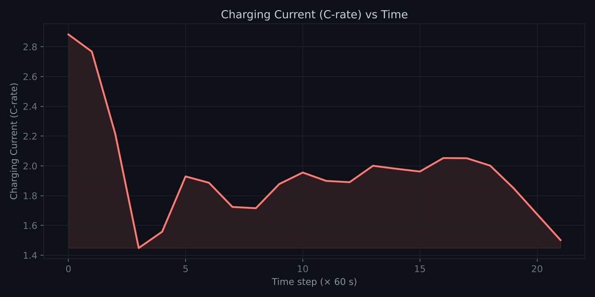
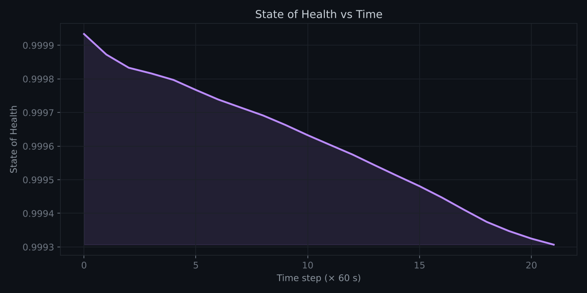

<p align="center">
  
</p>

<p align="center">
  <a href="https://devrajsingh07.streamlit.app"></a>
  
  
  
  
</p>

> [!NOTE]
> This project was built during my research internship at **NoonRay Energy Pvt. Ltd.**, under the guidance of
> **Kaushal Sir, CEO of NoonRay Energy Pvt. Ltd.** See [Acknowledgements](#acknowledgements).

---

## Overview

Fast charging is a trade-off. Push more current and the cell fills faster, but it also heats up, approaches its
voltage limit sooner and ages faster. Conventional CC-CV charging handles this with fixed, conservative rules.

This project trains a **Soft Actor-Critic (SAC)** agent to choose the charging current every simulated minute,
using the cell's live state of charge, voltage, temperature and state of health. The cell is simulated with a
simplified **Single Particle Model (SPM)** of an NMC 622 lithium-ion cell, a lumped thermal model and a CC-CV
charger. A **Streamlit dashboard** lets you run the trained agent or a fixed C-rate and inspect every signal.

| | |
|---|---|
| **Controller** | SAC (Stable-Baselines3, `MlpPolicy`), 20 000 training steps |
| **Cell model** | Single Particle Model · NMC 622 / graphite · 3 Ah, 18650 format |
| **Observation** | `[SOC, terminal voltage, temperature, SOH]` |
| **Action** | Requested charging current, `0.5C – 3.0C` (1.5 – 9 A) |
| **Charger** | CC-CV: the requested current until 4.20 V, then constant voltage with tapering current |
| **Episode ends** | SOC ≥ 80 % (success) · T ≥ 45 °C · SOH ≤ 0.80 · 3 h time limit |
| **Interface** | Streamlit + Plotly dashboard |

---

## How it works



Each step simulates **60 seconds** of charging:

1. **Charger.** The agent requests a C-rate. The charger applies it unless that would push the terminal
   voltage above 4.20 V. Past that point it holds 4.20 V and the current tapers, as a real CC-CV charger does.
2. **Electrochemistry.** SOC is updated by Coulomb counting, and the terminal voltage is computed as
   `V = OCV(SOC) + i·R_int(T) + η(i, T)`.
3. **Heat.** Ohmic and reaction heat warm the cell, which cools to a 25 °C ambient.
4. **Ageing.** SOH drops with current stress (`∝ C-rate²`) and with time spent above 35 °C.
5. **Reward.** The agent earns reward for charge added and pays for every minute spent, for heat above 35 °C
   and for capacity lost.

<details>
<summary><b>Physics model details</b></summary>

<br/>

| Term | Description |
|------|-------------|
| `OCV(SOC)` | Full-cell open-circuit voltage: degree-6 polynomial, 3.00 V at 0 % → 3.70 V at 50 % → 4.20 V at 100 % |
| `R_int(T)` | Internal resistance, 48 mΩ at 25 °C, falling 0.5 mΩ/°C above 25 °C (floor 10 mΩ) |
| `η(i, T)` | Butler-Volmer overpotential, `(RT/αF)·asinh(i / 2i₀)` with an Arrhenius-like `i₀(T)` |
| `ΔSOC` | Coulomb counting, `i·Δt / (3600·C_nom)` with `C_nom = 3 Ah`, `Δt = 60 s` |
| Thermal | `m·c_p·dT/dt = i²·R_int + i·η − hA·(T − T_amb)`, with `m·c_p = 45 J/K` and `hA = 0.20 W/K` |
| CV limit | Largest current with `V ≤ 4.20 V`, solved by bisection each step |
| SOH | `−8e-6·C² − 1.5e-5·max(T − 35, 0)` per step |

References: Doyle, Fuller & Newman (1993) · Marquis et al. (2019) · Chen et al. (2020).

</details>

<details>
<summary><b>Reward function</b></summary>

<br/>

```text
r =  200 · ΔSOC                     # charge added this step (140 in total for 10 → 80 %)
  −    1                            # each minute of charging time
  −    1 · max(T − 35, 0)           # heat above the comfort zone
  − 4000 · ΔSOH_loss                # capacity lost this step
  −  100   if T ≥ 45 °C             # safety limit reached (episode ends)
```

</details>

---

## Results

One episode per policy from 10 % SOC at 25 °C, reproduced with `python results/compare_policies.py`.
Each baseline is a standard CC-CV charge at a fixed C-rate.

<p align="center">
  
</p>

| Policy | Time to 80 % | Peak temperature | Final SOH | CV phase from |
|---|---:|---:|---:|---:|
| **SAC agent** | **22 min** | **35.2 °C** | **0.9993** | 76 % SOC |
| CC-CV 1C | 42 min | 28.0 °C | 0.9997 | — |
| CC-CV 2C | 22 min | 35.3 °C | 0.9993 | 76 % SOC |
| CC-CV 3C | 16 min | 44.3 °C | 0.9977 | 65 % SOC |

- The agent reaches 80 % in **half the time of standard 1C charging**.
- **3C is 6 minutes faster** but peaks at 44.3 °C, 0.7 °C below the safety limit, and costs about three
  times the capacity loss.
- The agent's profile is adaptive. It opens at about 2.9C while the cell is cool, drops back once the cell
  nears 35 °C, then holds between 1.7C and 2C until the charger's CV phase takes over at 76 %.
- From this one starting condition, the agent ends up matching a well-chosen fixed 2C rate.

<details>
<summary><b>Agent signal plots (<code>results/generate_plots.py</code>)</b></summary>

<br/>

<table>
  <tr>
    <td></td>
    <td></td>
  </tr>
  <tr>
    <td></td>
    <td></td>
  </tr>
  <tr>
    <td colspan="2"></td>
  </tr>
</table>

</details>

---

## Quick start

```bash
git clone https://github.com/devendrarajsingh07/AI_Battery_Fast_Charging.git
cd AI_Battery_Fast_Charging
pip install -r requirements.txt

# open the dashboard
streamlit run dashboard/app.py

# or run the pre-trained agent in the terminal
python agent/test_continuous_sac.py
```

The dashboard has four tabs: **Live Simulation**, **Analysis** (agent vs manual side by side),
**Battery Model** (OCV and resistance curves, parameters, equations) and **About**.

### Train your own agent

```bash
python agent/train_sac.py            # 20 000 timesteps, about 5 min on a CPU
```

The model is saved to `results/models/continuous_sac_model.zip`. Delete the existing file to retrain from
scratch.

### Regenerate the plots

```bash
python results/compare_policies.py   # agent vs CC-CV baselines (table + chart)
python results/generate_plots.py     # signal plots for one agent episode
```

---

## Project structure

```text
AI_Battery_Fast_Charging/
├── agent/
│   ├── train_sac.py               # train the SAC agent
│   ├── test_continuous_sac.py     # run the trained agent on the SPM environment
│   └── test_sac.py                # run the basic environment with a loaded model
├── battery_model/
│   ├── spm_model.py               # Single Particle Model: OCV, R_int(T), overpotential
│   └── thermal_model.py           # I²R heating + convective cooling
├── env/
│   ├── continuous_pybamm_env.py   # 4-state SPM environment (used for training)
│   ├── battery_env.py             # simple 3-state environment
│   └── pybamm_env.py              # direct PyBaMM environment (slow, reference only)
├── dashboard/
│   └── app.py                     # Streamlit dashboard
├── results/
│   ├── models/continuous_sac_model.zip
│   ├── plots/                     # generated charts
│   ├── compare_policies.py
│   └── generate_plots.py
└── assets/banner.svg
```

---

## Tech stack

| Package | Used for |
|---|---|
| `stable-baselines3` | SAC implementation |
| `gymnasium` | RL environment API |
| `torch` | Neural-network backend |
| `streamlit` · `plotly` | Interactive dashboard |
| `numpy` · `pandas` · `matplotlib` | Simulation data and static plots |
| `pybamm` *(optional)* | Electrochemical reference model for `pybamm_env.py` |

---

## Known limitations

- **One starting condition.** Training and evaluation both start at 10 % SOC and 25 °C. In this case a
  well-tuned fixed rate (2C) is already close to optimal. An adaptive policy should pay off when the starting
  charge and ambient temperature vary, which the environment does not randomise yet.
- **Simplified models.** The OCV curve, thermal and ageing models are representative, hand-calibrated
  approximations. They have not been validated against measured cell data.
- **No lithium-plating model.** Ageing depends only on current and temperature, so the risk of plating
  during high-current charging at high SOC or low temperature is not captured.

## Roadmap

- [ ] Randomised starting SOC and ambient temperature during training
- [ ] Lithium-plating-aware ageing term
- [ ] Full PyBaMM state coupling (solid diffusion, electrolyte dynamics)
- [ ] Calibrate ageing against public datasets (NASA, Oxford battery degradation)
- [ ] Multi-cell pack simulation
- [ ] Digital twin / hardware-in-the-loop export

---

## Acknowledgements

This work was carried out during my research internship at **NoonRay Energy Pvt. Ltd.**, under the guidance
of **Kaushal Sir, CEO of NoonRay Energy Pvt. Ltd.**

## Author

**Devendra Raj Singh** · B.Tech CSE (AI & ML), KIIT University
[GitHub](https://github.com/devendrarajsingh07)
