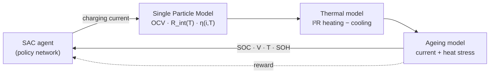

<p align="center">
  
</p>

<p align="center">
  <a href="https://devrajsingh07.streamlit.app"></a>
  
  
  
  
</p>

> [!NOTE]
> This project was built during my research internship at **NoonRay Energy Pvt. Ltd.**, under the guidance of
> **Kaushal Sir, CEO of NoonRay Energy Pvt. Ltd.** See [Acknowledgements](#acknowledgements).

---

## Overview

Fast charging is a trade-off. Push more current and the cell fills faster, but it also heats up, approaches its
voltage limit sooner and ages faster. Conventional CC-CV charging handles this with fixed, conservative rules.

This project trains a **Soft Actor-Critic (SAC)** agent to choose the charging current every simulated minute,
using the cell's live state of charge, voltage, temperature and state of health. The cell is simulated with a
simplified **Single Particle Model (SPM)** of an NMC 622 lithium-ion cell plus a lumped thermal model. A
**Streamlit dashboard** lets you run the trained agent or a fixed current side by side and inspect every signal.

| | |
|---|---|
| **Controller** | SAC (Stable-Baselines3, `MlpPolicy`), 20 000 training steps |
| **Cell model** | Single Particle Model · NMC 622 OCV fit (Chen 2020) · 3 Ah cell |
| **Observation** | `[SOC, terminal voltage, temperature, SOH]` |
| **Action** | Charging current, continuous, `0.5 – 3.0` |
| **Safety stops** | SOC ≥ 80 % · T ≥ 45 °C · V ≥ 4.20 V · SOH ≤ 0.80 |
| **Interface** | Streamlit + Plotly dashboard |

---

## How it works



Each step simulates **60 seconds** of charging:

1. **Electrochemistry.** SOC is updated by Coulomb counting, and the terminal voltage is computed as
   `V = OCV(SOC) + i·R_int(T) + η(i, T)`.
2. **Heat.** The cell warms with `I²R` heating and loses heat to a 25 °C ambient.
3. **Ageing.** SOH drops with current stress (`∝ i²`) and with time spent above 35 °C.
4. **Reward.** The agent is rewarded for charge gained and penalised for approaching the voltage limit,
   running hot and losing health.

<details>
<summary><b>Physics model details</b></summary>

<br/>

| Term | Description |
|------|-------------|
| `OCV(SOC)` | Open-circuit voltage: degree-6 polynomial fit for NMC 622 (Chen 2020 half-cell data) |
| `R_int(T)` | Internal resistance, 48 mΩ at 25 °C, falling 0.5 mΩ/°C above 25 °C (floor 10 mΩ) |
| `η(i, T)` | Butler-Volmer overpotential, `(RT/αF)·asinh(i / 2i₀)` with an Arrhenius-like `i₀(T)` |
| `ΔSOC` | Coulomb counting, `i·Δt / (3600·C_nom)` with `C_nom = 3 Ah`, `Δt = 60 s` |
| Thermal | `T += 0.2·i² − 0.05·(T − T_amb)` per step |
| SOH | `−8e-6·i² − 1.5e-5·max(T − 35, 0)` per step |

References: Doyle, Fuller & Newman (1993) · Marquis et al. (2019) · Chen et al. (2020).

</details>

<details>
<summary><b>Reward function</b></summary>

<br/>

```text
R =  20 · SOC
  − 600 · max(V − 4.10, 0)                     # stay clear of the voltage cutoff
  −   8 · max(T − 35, 0)                       # temperature above the comfort zone
  − 120 · (1 − SOH)                            # ageing
  −   2 · (i − 2.0) · (T − 32)   if T > 32 and i > 2.0   # no high current when already warm
```

</details>

---

## Results

One episode per policy from 10 % SOC, reproduced with `python results/compare_policies.py`:

<p align="center">
  
</p>

| Policy | Charge time | Final SOC | Peak temperature | Final SOH | Episode ended by |
|---|---:|---:|---:|---:|---|
| **SAC agent** | **40 min** | **52.7 %** | **37.5 °C** | **0.9983** | 4.20 V cutoff |
| Constant 1.5 | 52 min | 53.3 % | 33.4 °C | 0.9991 | 4.20 V cutoff |
| Constant 2.0 | 38 min | 52.2 % | 38.7 °C | 0.9981 | 4.20 V cutoff |
| Constant 2.5 | 30 min | 51.7 % | 44.6 °C | 0.9967 | 4.20 V cutoff |

The agent ramps the current from about 1.8 up to 2.1 while the cell is cool, then backs off to about 1.8 once it
passes 35 °C. It charges
12 minutes faster than the gentle 1.5 profile, and runs 1.2 °C cooler than a fixed 2.0 for only 2 extra minutes.
The aggressive 2.5 profile is fastest but finishes within half a degree of the 45 °C safety limit.

<details>
<summary><b>Single-episode signal plots (fixed 1.7 current, <code>results/generate_plots.py</code>)</b></summary>

<br/>

<table>
  <tr>
    <td></td>
    <td></td>
  </tr>
  <tr>
    <td></td>
    <td></td>
  </tr>
  <tr>
    <td colspan="2"></td>
  </tr>
</table>

</details>

---

## Quick start

```bash
git clone https://github.com/devendrarajsingh07/AI_Battery_Fast_Charging.git
cd AI_Battery_Fast_Charging
pip install -r requirements.txt

# open the dashboard
streamlit run dashboard/app.py

# or run the pre-trained agent in the terminal
python agent/test_continuous_sac.py
```

The dashboard has four tabs: **Live Simulation**, **Analysis** (agent vs manual side by side),
**Battery Model** (OCV and resistance curves, parameters, equations) and **About**.

### Train your own agent

```bash
python agent/train_sac.py            # 20 000 timesteps, about 5 min on a CPU
```

The model is saved to `results/models/continuous_sac_model.zip`. Delete the existing file to retrain from
scratch.

### Regenerate the plots

```bash
python results/compare_policies.py   # agent vs constant current (table + chart)
python results/generate_plots.py     # signal plots for a fixed 1.7 current
```

---

## Project structure

```text
AI_Battery_Fast_Charging/
├── agent/
│   ├── train_sac.py               # train the SAC agent
│   ├── test_continuous_sac.py     # run the trained agent on the SPM environment
│   └── test_sac.py                # run the basic environment with a loaded model
├── battery_model/
│   ├── spm_model.py               # Single Particle Model: OCV, R_int(T), overpotential
│   └── thermal_model.py           # I²R heating + convective cooling
├── env/
│   ├── continuous_pybamm_env.py   # 4-state SPM environment (used for training)
│   ├── battery_env.py             # simple 3-state environment
│   └── pybamm_env.py              # direct PyBaMM environment (slow, reference only)
├── dashboard/
│   └── app.py                     # Streamlit dashboard
├── results/
│   ├── models/continuous_sac_model.zip
│   ├── plots/                     # generated charts
│   ├── compare_policies.py
│   └── generate_plots.py
└── assets/banner.svg
```

---

## Tech stack

| Package | Used for |
|---|---|
| `stable-baselines3` | SAC implementation |
| `gymnasium` | RL environment API |
| `torch` | Neural-network backend |
| `streamlit` · `plotly` | Interactive dashboard |
| `numpy` · `pandas` · `matplotlib` | Simulation data and static plots |
| `pybamm` *(optional)* | Electrochemical reference model for `pybamm_env.py` |

---

## Known limitations

- **No constant-voltage phase.** Every episode ends at the 4.20 V cutoff at roughly 52 % SOC, before the
  80 % target. A CV stage, or letting the agent taper current near the limit, is needed to reach full charge.
- **Current units.** The dashboard labels the action as a C-rate, but the cell model applies it in amps.
  On the 3 Ah cell, an action of 3.0 is 1C.
- **Simplified models.** The thermal and ageing models are lumped, hand-calibrated approximations. They
  have not been validated against measured cell data.
- **Single starting condition.** Results come from one deterministic episode from 10 % SOC at 25 °C.

## Roadmap

- [ ] CC-CV baseline and a constant-voltage phase in the environment
- [ ] Full PyBaMM state coupling (solid diffusion, electrolyte dynamics)
- [ ] Calibrate ageing against public datasets (NASA, Oxford battery degradation)
- [ ] Randomised starting SOC and ambient temperature during training
- [ ] Multi-cell pack simulation
- [ ] Digital twin / hardware-in-the-loop export

---

## Acknowledgements

This work was carried out during my research internship at **NoonRay Energy Pvt. Ltd.**, under the guidance
of **Kaushal Sir, CEO of NoonRay Energy Pvt. Ltd.**

## Author

**Devendra Raj Singh** · B.Tech CSE (AI & ML), KIIT University
[GitHub](https://github.com/devendrarajsingh07)
